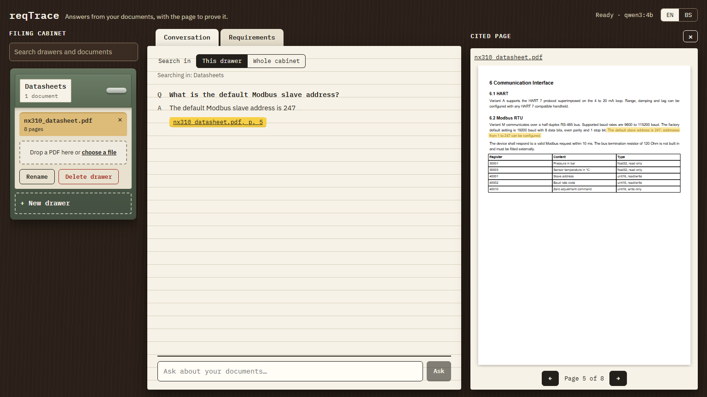
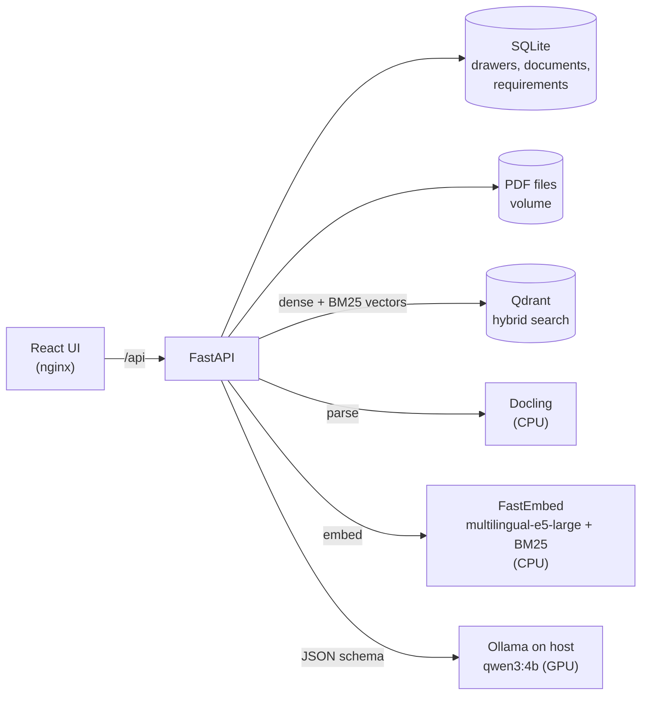

# reqTrace

> **Status:** work in progress. The core features work and are tested; evaluation on real datasheets is next (see Roadmap).

reqTrace is a self-hosted assistant for technical documentation such as datasheets,
manuals and standards. It answers questions only from your PDFs and cites the file and
page for every answer. When the documents do not contain the answer, it says so instead
of guessing. It also extracts the obligations and limits from a document into a table
you can export to CSV or Excel. Every row is a verbatim quote found on its page of the
original PDF. Everything runs locally: FastAPI, Qdrant, CPU embeddings and a small LLM in
Ollama sized for a 6 GB GPU.



## Features

- **Answers with citations.** Hybrid search (dense + BM25, fused with RRF in Qdrant)
  finds the 8 best distinct chunks, at most 2 from one page. The LLM copies evidence from every relevant chunk, decides
  whether it answers the question, and writes the answer as claims that each cite the
  chunks stating them. A claim without a valid citation, or with a number none of its
  chunks contains, is dropped, and the sources are exactly the cited chunks. The answer
  is written in the language of the question (English or Bosnian).
- **Evidence highlighted on the page.** Clicking a source or a requirement's page chip
  opens the PDF page with the evidence passage marked in yellow. If the passage cannot
  be located exactly, the page is shown without a mark.
- **Obligation and limit extraction** (see [What is extracted](#what-is-extracted)).
  1. Sections that cannot hold either are skipped before any model call. This covers
     features, description, register maps, revision history, legal notices and
     tables of known shapes such as test steps or troubleshooting.
  2. Rows of ratings and operating-conditions tables are read directly as limits.
  3. The remaining text goes to the LLM in a few grouped calls.
  4. Every proposed quote must be found on its page of the PDF's own text layer. The
     stored quote is the exact span of page text, never the model's transcription.
  5. Fixed rules then decide whether the quote is an obligation, a limit or a
     description; descriptions are dropped.
  6. An optional paraphrase is kept only if it is faithful to the quote. When it is
     not, the row keeps the quote and the paraphrase is left empty.

  The summary reports rows saved, quotes not found, descriptions dropped, sections
  skipped and the time taken. Results get codes `REQ-001`, … and export to CSV and XLSX.
- **Drawers.** Documents live in drawers. A question can search one drawer, chosen
  documents (API) or the whole cabinet. Temporary drawers delete their documents
  24 hours after upload.
- **Exact pages.** Chunks follow the document structure (sections, and every table as its
  own chunk with its heading path) and never span pages, so citations are exact.
- **No noise in the index.** Repeated page headers and footers, labels from package
  drawings, bare dates, page numbers and part codes are dropped at ingestion, as is text
  that repeats an earlier chunk of the same document. Short text with a value and a unit
  ("VDD 1.8 V") or an instruction ("Ground the pad.") is kept. Documents uploaded before
  this filter existed must be uploaded again for it to apply.
- **Web UI in English and Bosnian.** A filing cabinet, a notepad (conversation and
  requirements) and a viewer that shows the cited PDF page. A "Developer mode" switch
  next to the language buttons (off by default, remembered in the browser) adds a "Why?"
  panel under "not in the documents" answers: the searched phrasings, the retrieved
  chunks with their scores and the discarded claims.
- **Honest failure modes.** Corrupt PDFs, scanned PDFs without text, an empty drawer,
  Qdrant or Ollama being unreachable, and invalid LLM JSON (retried once) each produce a
  clear message.

## What is extracted

reqTrace extracts exactly two kinds of item, and the table shows which one each row is:

- **Obligation**: the designer, implementer or user is told to do or not to do
  something. This covers "shall" and "must" sentences, explicit recommendations ("is
  recommended", "should"), and instructions such as "Use ...", "Avoid ..." or "Place ...",
  also after a short introductory phrase ("Below the summary row, add ...", "Before the
  lecture, read ..."). "When a filter matches nothing, the empty state says so" stays
  out: after the comma comes a subject with its verb, not an instruction.
- **Limit**: a specified boundary the product must be operated within, with values and
  units. Typically this is a row of an absolute maximum ratings or recommended operating
  conditions table.

Instructions about how the work is done (testing, committing, pushing, submitting,
uploading) are obligations of type `process`, whatever type the model proposed.

**Timing tables are never limits.** Rows of a timing-requirements or
switching-characteristics table (clock frequency, hold time, rise time) describe bus
behaviour and depend on the bus mode; reqTrace treats all of them the same way and
extracts none of them as limits, even when a row contains "max". A sentence elsewhere
that tells the designer to respect a timing value is still an obligation.

Everything else is deliberately left out. That includes feature lists, overview and
marketing text, typical performance values and graphs, register and bit-field
documentation, footnotes, table headers, revision history, tables of contents, ordering
and packaging information, related documentation, trademarks, legal notices,
troubleshooting tables, test inputs and summaries.

**Descriptions of how the device behaves are not extracted, even when they matter.**
"The device acknowledges each data byte" is useful knowledge, but nobody is told to do
anything, so it is not a row in this table. Ask about it in the conversation instead.
A requirement written as a plain present-tense statement ("Each row shows the trail
name") is left out for the same reason.

## Architecture



See [docs/architecture.md](docs/architecture.md) for the ingestion, question and
extraction flows.

## Quick start

Requirements: Docker with Compose, and [Ollama](https://ollama.com) on the host.

```bash
ollama pull qwen3:4b          # about 2.5 GB, fits in 6 GB of VRAM
git clone <this repository> reqtrace && cd reqtrace
docker compose up --build
```

Open <http://localhost:8080> for the UI and <http://localhost:8000/docs> for the API.
If port 8080 is already in use, start with another one, for example
`FRONTEND_PORT=8090 docker compose up --build`.

The first upload downloads the Docling layout models and the embedding models (about
2.5 GB in total) into the `reqtrace_data` volume, so it takes several minutes and needs
internet access. Later uploads of a short datasheet take about 30 seconds on a CPU.

### Without Docker (development)

```bash
docker run -d -p 6333:6333 qdrant/qdrant:v1.20.0
uv venv --python 3.12 && uv pip install -e ".[dev]"   # or: python -m venv .venv && pip install -e ".[dev]"
uvicorn app.main:app --reload --port 8000
cd frontend && npm ci && npm run dev                  # http://localhost:5173
```

### Choosing the model

`qwen3:4b` is the default because it fits fully on a 6 GB GPU with an 8192-token
context. For better answers, `qwen3:8b` (5.2 GB) is an option: set `LLM_MODEL=qwen3:8b`.
On a 6 GB card part of it runs on the CPU, so it is noticeably slower. The newer
`qwen3.5:4b` is also worth trying. The evaluation below was run only with `qwen3:4b`.

## Configuration

All settings are environment variables (or a `.env` file; see `.env.example`).

| Variable | Default | Purpose |
|---|---|---|
| `DATA_DIR` | `./data` | SQLite database and uploaded PDFs |
| `DATABASE_URL` | SQLite in `DATA_DIR` | SQLAlchemy URL |
| `MODELS_CACHE_DIR` | FastEmbed default | Where embedding models are cached |
| `QDRANT_URL` | `http://localhost:6333` | Qdrant server |
| `QDRANT_COLLECTION` | `reqtrace_chunks` | Collection name |
| `DENSE_MODEL` | `intfloat/multilingual-e5-large` | FastEmbed dense model |
| `DENSE_QUERY_PREFIX` / `DENSE_PASSAGE_PREFIX` | `query: ` / `passage: ` | E5 prefixes; empty for other models |
| `SPARSE_MODEL` | `Qdrant/bm25` | Sparse model |
| `EMBEDDING_THREADS` | all cores | CPU threads for embeddings |
| `OLLAMA_BASE_URL` | `http://localhost:11434` | Ollama (Docker: `http://host.docker.internal:11434`) |
| `LLM_MODEL` | `qwen3:4b` | Ollama model tag |
| `LLM_NUM_CTX` | `8192` | Context window |
| `LLM_TIMEOUT_SECONDS` | `300` | Per-request timeout |
| `LLM_THINK` | `false` | Thinking mode for free-text calls (structured calls always off) |
| `RETRIEVAL_TOP_K` | `8` | Chunks given to the LLM (maximum 10) |
| `RETRIEVAL_MAX_PER_PAGE` | `2` | At most this many of those chunks from one page |
| `RETRIEVAL_PREFETCH_LIMIT` | `20` | Candidates per search before fusion |
| `CHUNK_MAX_CHARS` / `CHUNK_OVERLAP_CHARS` | `1500` / `200` | Chunk size and overlap |
| `INGEST_MIN_WORDS` | `1` | A text or table block with fewer words (two or more letters; capitals-only tokens in short text do not count) is not indexed unless it holds a value with a unit or an instruction; `0` turns this off |
| `INGEST_REPEATED_MIN_PAGES` | `3` | Short text found on at least this many pages is a page header or footer and is not indexed; `0` turns this off |
| `INGEST_REPEATED_MAX_CHARS` | `60` | Longest text that can count as a header or footer |
| `MAX_UPLOAD_MB` | `50` | Upload size limit |
| `TEMPORARY_TTL_HOURS` | `24` | Lifetime of documents in temporary drawers |
| `CLEANUP_INTERVAL_MINUTES` | `15` | How often expired documents are removed |
| `QUOTE_MATCH_THRESHOLD` | `90` | Fuzzy match score (0–100) a quote needs |
| `QUOTE_MIN_CHARS` | `15` | Shorter quotes are rejected |
| `REQUIREMENT_SUPPORT_THRESHOLD` | `0.75` | Share (0–1) of a paraphrase's significant terms its quote must contain |
| `EXTRACTION_SKIP_SECTIONS` | features, description, register maps, … | JSON list of heading words whose sections are skipped before any model call |
| `EXTRACTION_PARAPHRASE` | `false` | Ask the model for a paraphrase of each quote (slower; see Evaluation) |
| `EXTRACTION_GROUP_CHARS` | `3000` | Size of one model call: consecutive chunks of a top-level section are grouped up to this many characters |
| `EXTRACTION_CONCURRENCY` | `1` | Parallel model calls; only useful when Ollama has parallel slots that fit in VRAM |
| `DEDUP_THRESHOLD` | `92` | Similarity above which requirements are merged |
| `CORS_ORIGINS` | `["http://localhost:5173"]` | Allowed browser origins |

## API overview

| Method and path | Purpose |
|---|---|
| `GET /health` | Status of the API, Qdrant and Ollama (and whether the model is pulled) |
| `POST /drawers` | Create a drawer (`name`, `is_temporary`) |
| `GET /drawers` | List drawers with document counts |
| `PATCH /drawers/{id}` | Rename a drawer |
| `DELETE /drawers/{id}` | Delete a drawer with its documents, vectors and files |
| `POST /drawers/{id}/documents` | Upload a PDF; returns `202` and ingests in the background |
| `GET /drawers/{id}/documents` | List documents and their status (`processing`, `ready`, `failed`); while processing, `ingest_pages_done` of `page_count` pages are parsed |
| `GET /documents/{id}/file` | The PDF |
| `DELETE /documents/{id}` | Delete a document with its vectors and file |
| `POST /ask` | `question`, optional `drawer_id`, optional `doc_ids` → `answer`, `answered`, `sources` (each with `filename`, `doc_id`, `page`, `snippet`, `highlight`) and `lines` (one per claim, with the indexes of its sources). With `"debug": true` (off by default) also `debug`: the searched phrasings, the retrieved chunks with rank, page and score, and each discarded claim with its reason |
| `POST /documents/{id}/requirements` | Start extraction (`202`); poll the GET endpoint for progress |
| `GET /documents/{id}/requirements` | The table (`kind`, `quote`, `page`, `type`, `paraphrase`, …), rejection counts, `skipped_sections`, `elapsed_seconds`; `?format=csv` or `?format=xlsx` to download (columns: ID, Kind, Quote (verbatim), Page, Type, Paraphrase (model), Verified) |

## Evaluation

`python -m eval.run_eval` indexes a document into a separate collection and runs a
question set in each search mode (`--mode dense|bm25|hybrid|all`). It reports:

- **Retrieval hit rate @5**: an expected page is among the 5 retrieved chunks.
- **Answer accuracy**: the answer is given and contains every expected keyword.
- **Abstention accuracy**: questions the document cannot answer get "not found".

Results of a real run (2026-11-18) on the synthetic test datasheet:

| Mode | Retrieval hit rate @5 | Answer accuracy | Abstention accuracy |
|---|---|---|---|
| dense | 97% | 97% | 100% |
| bm25 | 97% | 97% | 100% |
| hybrid | 97% | 97% | 100% |

30 answerable and 7 unanswerable questions · LLM `qwen3:4b` ·
dense embeddings `intfloat/multilingual-e5-large` · 569 s for all three modes on an
RTX 3050 (6 GB). The numbers did not change after duplicate removal and noise
filtering were added to retrieval and ingestion. The set includes Bosnian questions
about the English document and values printed in other notations ("0.1-µF",
"four"). The same set with the code before cross-language retrieval and the
improved number matching gave 93% / 90% / 93% answer accuracy and the same 100% abstention:
the Bosnian questions about the transmitter count were refused. The hit rate is still
measured on the first 5 chunks, although the model now sees 8. The one remaining
"miss" is the weight question: in dense and hybrid mode the answer "approximately 120
grams" is correct but does not contain the keyword "120 g"; in BM25 mode it was refused.

**Read these numbers with care.** The test document is an 8-page datasheet for a
*fictional* product, generated by [eval/make_sample_pdf.py](eval/make_sample_pdf.py),
because no third-party PDF ships with the repository. It is clean, born-digital and
small, so retrieval is easy, and the three modes cannot be told apart on it. The
questions were written from the document text (see
[eval/questions.jsonl](eval/questions.jsonl)). The only retrieval miss, in every mode,
is the product weight, which sits in a long table (it is found within the 8 chunks). Run the evaluation on a real
datasheet before drawing conclusions:

```bash
python -m eval.run_eval --pdf samples/your_datasheet.pdf --questions your_questions.jsonl
```

### Requirement extraction

`python -m eval.run_extraction_eval` runs extraction on synthetic fixtures with labelled
ground truth ([eval/extraction_fixtures.py](eval/extraction_fixtures.py)):

- **reading**: a reading with nothing to extract (description plus a table of default
  values);
- **lab assignment**: a lab with fifteen imperative or "must" tasks (three of them after
  an introductory phrase or about testing), mixed with learning objectives, a
  description after an introductory phrase ("When a filter matches nothing, the empty
  state says so."), code, a test table, a troubleshooting table and closing remarks;
- **datasheet**: a datasheet-style document with a feature list, overview, revision
  history, absolute maximum ratings, recommended operating conditions, a register map,
  behaviour descriptions, layout guidelines, a troubleshooting table and a legal notice.

Results of a real run with `qwen3:4b`, paraphrase off (2026-11-16):

| Fixture | Rows | Precision obligation | Recall obligation | Precision limit | Recall limit | s/call |
|---|---|---|---|---|---|---|
| reading | 0 | n/a | n/a | n/a | n/a | 4.9 |
| lab assignment | 15 | 1.00 | 1.00 | n/a | n/a | 3.1 |
| datasheet | 11 | 1.00 | 1.00 | 1.00 | 0.83 | 4.3 |

The missed limit is "Voltage at SCL, SDA and ALERT". Docling reads that two-line table
cell in the wrong word order, so the row cannot be matched to the page text. The
fixtures were written alongside the rules they test; they show that the targeted
failure modes are handled, not how well the rules generalise.

`python -m eval.run_extraction_eval --pdf <file>` measures an unlabelled document. On
the public TI TMP117 datasheet (50 pages, not shipped with the repository) the tables
compare the previous version with the current one.

Pipeline:

| | Previous version | Current |
|---|---|---|
| Chunks sent to the model | 187 (187 calls) | 27 (9 calls), plus 2 ratings tables read directly |
| Sections and tables skipped | 0 | 78 |
| Output tokens | 51,964 | 3,447 |
| Extraction time (RTX 3050, model 100% on the GPU) | 1,193 s | 89 s |

Results:

| | Previous version | Current |
|---|---|---|
| Rows saved | 334 (137 typed "other") | 50 (40 obligations, 10 limits) |
| Rejected: quote not on page | 160 | 1 |
| Rejected: requirement not supported / not an obligation or limit | 96 | 33 |

The ten limits were the eight rows of the absolute maximum ratings and recommended
operating conditions tables, a bus timing row and the stated supply range. Timing
rows are now never limits: a Docker run after that change saved 48 rows (39
obligations, 9 limits) in 100 s, and the timing row is gone. The
obligations come from the pin table, the application, power-supply and layout sections.

**Paraphrase on or off.** The paraphrase changes no row on the fixtures, but it doubles
the generated text. Per model call it took 3.7 s instead of 2.3 s on the lab and 10.1 s
instead of 6.7 s on the datasheet. On TMP117 the run took 142 s instead of 89 s. It is
therefore off by default (`EXTRACTION_PARAPHRASE`).

**Parallel requests.** With `OLLAMA_NUM_PARALLEL=2` the model no longer fits in 6 GB:
5.4 GB, 21% on the CPU. Two parallel calls took 101 s against 89 s for one call on a
normal server, so extraction stays sequential (`EXTRACTION_CONCURRENCY=1`).

## Design decisions

- **Why hybrid search.** Datasheets mix prose with part numbers, register addresses and
  exact values. BM25 matches tokens like `40010` or `IP69K` that dense embeddings blur.
  Dense search matches paraphrases and other languages (a Bosnian question finds an
  English datasheet). Qdrant fuses both with Reciprocal Rank Fusion, so there is no
  hand-tuned weighting.
- **Why the quote is the requirement.** A requirement table is only useful if every row
  can be trusted. The model proposes quotes; reqTrace finds each one in the original
  PDF's text layer and stores the matched page text itself. Whether that text is an
  obligation, a limit or a description is decided by fixed rules on the quote, not by
  the model's opinion. A paraphrase, when enabled, is shown only if it uses the quote's
  terms, numbers and strength, and never adds "must" to a plain statement.
- **Why skip sections first.** On a 50-page datasheet most text is features, behaviour
  descriptions, register maps and legal pages. Skipping them by heading before any
  model call removed more than 80% of the chunks, most of the false rows and most of the
  time.
- **Why CPU embeddings.** On a 6 GB GPU every megabyte goes to the LLM and its context.
  Embedding a datasheet on the CPU takes seconds, while a model that does not fit in VRAM
  is many times slower.
- **Structured output everywhere.** Both answers and extraction use JSON schemas with
  temperature 0 and thinking off. For answers the field order matters: evidence first,
  then the decision, then the answer. With the decision first, the 4B model abstained on
  most answerable questions (answer accuracy 24% → 96% after the change).

More decisions, including where the build differs from the original plan, are in
[docs/decisions.md](docs/decisions.md).

## Limitations

- **No OCR.** Scanned PDFs are rejected with a clear message.
- **The rules are lexical.** Obligations are recognised by wording and by a list of
  instruction verbs, and limits by numbers in ratings sections or next to boundary
  words. A recommendation phrased unusually is missed, and a descriptive sentence that
  happens to contain "recommended" or "required" can be kept (for example "The
  recommended PCB layout minimizes self-heating"). The verbatim quote is always shown.
- **Skipping depends on headings.** Sections are skipped by their heading path. If the
  PDF parser misses a heading, its text is judged as part of the previous section.
  Documents ingested with an older version of reqTrace keep their old section paths;
  upload them again to get the improved section detection.
- **Only the model's candidates are judged.** If the model does not propose an
  obligation, the rules never see it. Recall on real documents is not measured.
- **Timing tables are never treated as limits** (see "What is extracted"). Only
  ratings and operating-conditions sections count as limit sections.
- **Heading detection varies.** On the same Docling version, the Linux container missed
  some section headings that the Windows host found, and merged them into the text
  (18 instead of 22 chunks for the test document). Page citations are unaffected because
  chunks never span pages, but section paths in prompts are less precise. The evaluation
  numbers above come from the Windows host run.
- **Small-model limits.** `qwen3:4b` sometimes misses rows or facts in long tables, and
  results can vary between runs.
- **Evaluation is synthetic** until it is run on real documents (see above).
- **No authentication.** Anyone who can reach the ports can read and delete documents.
  Run it on a trusted machine or network.
- **Conversation history lives in the browser tab** and is lost on reload.

## Roadmap

- Evaluation on a set of real, public datasheets, including requirement recall.
- Choosing documents for a question in the UI (the API already supports `doc_ids`).
- OCR for scanned documents as an optional pipeline.
- Re-ranking retrieved chunks with a cross-encoder on long documents.

## Development

```bash
ruff check . && ruff format --check .
pytest -q                                   # no GPU, Ollama or network needed
cd frontend && npm run check:i18n && npm run format:check && npm test && npm run build
```

## License

MIT, see [LICENSE](LICENSE).
